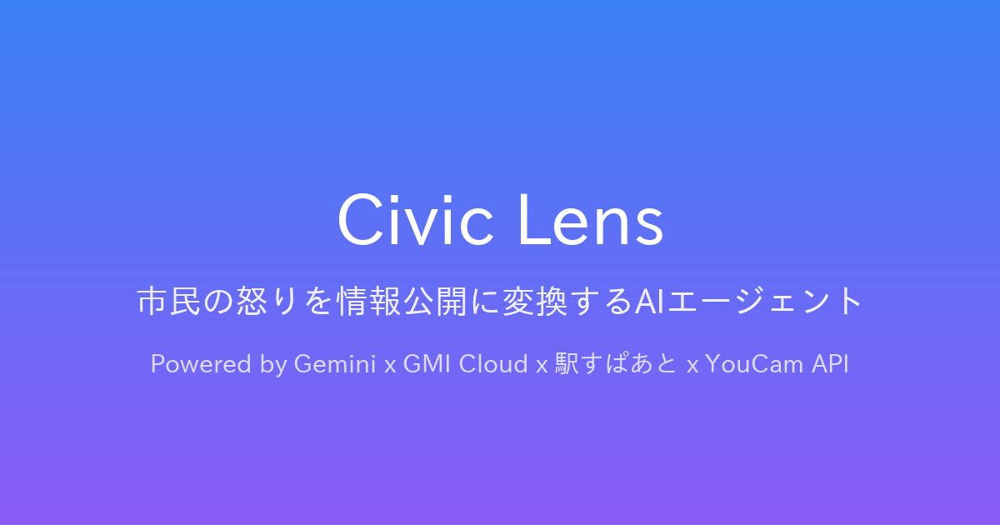

# Civic Lens — 市民の怒りを情報公開に変換するAIエージェント

[](https://github.com/t-sakaki/civic-lens/actions/workflows/ci.yml)
[](https://civic-lens-259303826380.asia-northeast1.run.app)
[](https://zenn.dev/hackathons/google-cloud-japan-ai-hackathon-vol5)



> 🏆 **2026年9月5日のZenn Agentic AI ミニハッカソン with Google Cloud（渋谷）で、参加者の中から選ばれました**（参加申込 約200名：[connpass](https://classmethod.connpass.com/event/398578/)）。コーディング時間約2時間という短時間実装での選出です。詳細は[🏆 受賞歴](#-受賞歴)をご覧ください。

## 🎯 概要

**Civic Lens**は、市民が行政に対して抱く「怒り・不信・諦め」を、**情報公開請求・審査請求**という法的アクションに自動変換するAIエージェントです。

国の行政機関への情報公開請求は年間約21.5万件（総務省、令和6年度施行状況調査 https://www.soumu.go.jp/main_content/001033108.pdf ）。市民は弁護士なしで、この制度を使いこなせるようになります。

## 💢 理念 — 「怒ることに疲れた市民」の代理人

多くの市民はニュースを見ても、心のどこかで違和感や怒りを覚えながら、それを表明する気力を失い、無関心を装うようになっている。声を上げても何も変わらない、という学習性の無力感が、行政の不透明さを温存させてしまう。

日本には公的なオンブズマン制度（行政監視官）が存在しない。Civic Lens はその機能的な空白を、AIエージェントで埋めることを目指す。**市民・国民の代わりにニュースへ怒り、その怒りを情報公開請求という具体的な行動に変換する**——これが本プロジェクトの中核的な理念である。

- 一見すると好意的・中立に報じられているニュース（華やかな式典、成功した大会、明るい統計）の裏にある、税金の使途・意思決定過程の不透明さ・住民負担を、AIエージェントが批判的な視点で読み解く
- その論点をもとに、怒っているはずの市民の声を疑似的に再現する（実在の個人の発言ではなくAIが生成したフィクションであることを常に明示する）
- 再現した怒りを、個人が実際に提出できる情報公開請求書の具体的な記載内容（対象機関・請求文書・根拠条例）へと変換する
- ユーザーが希望すれば、その声を自分自身のX/Blueskyアカウントから発信し、シビック・ガバナンス（市民による行政監視）を可視化する

これにより、「怒ることに疲れた」市民に代わってAIが怒り、行政監視を持続可能な形で機能させることを目指す。詳細なエージェント構成は [AGENTS.md](AGENTS.md#-ニュース怒り再現パイプライン新規エージェント構成) を参照。

## 🏛️ 解決する課題

### 市民のペイン
- **「何を請求していいかわからない」** — 「何を請求していいかわからない」という壁で、多くの市民が請求をあきらめています
- **「不開示だったらどうするか」がわからない** — 審査請求フローがブラックボックス化
- **「弁護士費用10万円」は払えない** — 法テラス（民事法律扶助）は償還原則
- **「役所は敵だ」という諦め** — 制度はあるが機能していない歪み

### 行政の不誠実
- **「不存在」を盾にした逃げ** — 形式的応答で実質隠蔽
- **抽象的・紋切り型の不開示理由** — 「法人情報」「事務執行影響」等の一般条項滥用
- **裁決の遅延** — 答申まで6ヶ月〜2年、事件の風化

## ✨ 機能

Civic Lens は、市民の「怒り・不信・諦め」を入力すると、AIが法的回答を返す：

| 市民の入力 | AI の出力 |
|---|---|
| 「許せない！腹が立つ！」 | 怒りレベル測定・条例マッチング |
| 「何百万円も使って成果が分からない」 | 開示請求書の自動生成 |
| 「不開示決定を受けた」 | 審査請求書 + 反論ロジック |

### 詳細機能

1. **条例自動マッチング（Gemini）** — 市民の怒り内容から適用条例を自動特定
3. **開示請求書・司法行政文書開示申出書の自動生成** — 17機関（7自治体・議会 + 4警察本部 + 6裁判所）対応。行政文書だけでなく裁判所の「司法行政文書の開示に関する事務の取扱要綱」に基づく開示請求にも完全対応
4. **審査請求書 + 反論ロジック生成** — 不開示決定への反論を判例・先例（自治体条例、警察情報公開規程、裁判所取扱要綱）を交えて構築。先例として提示する認容事例は、総務省「行政不服審査裁決・答申検索データベース」から収集した実在のデータをGemini Embeddingsによるベクトル検索で照合したものを使用し、Geminiによる先例の「創作」を防止
5. **期限管理（60日ルール等）** — Cloud Scheduler で自動通知
7. **シチュエーション別テンプレート** — 13種類（海外視察、公共事業、補助金、警察事案、裁判所司法行政・予算執行等）から選ぶだけ
8. **ニュース怒り再現エージェント** — 地域名からその地域の自治体・警察・公的行事に関するニュースを自動収集（NewsCollectorAgent）。一見好意的なニュースの裏にある論点を批判的に読み解き、市民の怒りの声を疑似生成（AngerReproductionAgent）、開示請求書の該当箇所まで自動生成する。分析結果には❤️😡😳のリアクションを付けて記録・履歴として振り返れる
9. **SNSシェア（X.com / Bluesky）** — 再現された「疑似的な市民の声」を、ユーザー自身のX/Blueskyアカウントから投稿できる（専用botアカウントは使わない）。投稿には必ずAI生成のフィクションである旨の免責を含める

## 🛠️ 技術スタック

**Google Cloud ADK (Agent Development Kit)** を中核に構築：

| スポンサー | 役割 | 実装 |
|---|---|---|
| **Google Cloud ADK + Vertex AI Agent Engine** | エージェント本体 | `agent.py`（LlmAgent + SequentialAgent）|
| **GMI Cloud (DeepSeek V4 Pro)** | 開発時（試作・検証）のLLM。本番では未使用 | `gmi_client.py` |
| **総務省 行政不服審査裁決・答申検索データベース + Gemini Embeddings** | 認容事例の実データ検索（先例の「創作」防止） | `precedent_cases.py`, `scripts/scrape_gyofuku_cases.py`, `scripts/build_precedent_embeddings.py` |

GMI CloudのLLMは開発時（試作・検証）にのみ使用しました。本番の実行はGemini APIで行っており、GMI Cloudは本番では使っていません。

### ADKアーキテクチャ
```
SequentialAgent (civic_lens_integrated)
   ├── LlmAgent (anger_analyzer) [Gemini 2.5 Pro]
   │     ├── FunctionTool: analyze_user_anger
   │     ├── FunctionTool: get_ordinance_info
   │     └── FunctionTool: get_situation_documents
   └── LlmAgent (counter_argument_builder) [Gemini 2.5 Pro]
         └── FunctionTool: get_counter_argument
```

### 補助技術
- **FastAPI** — Python Web フレームワーク
- **Tailwind CSS** — UI
- **Cloud Run** — デプロイ
- **Cloud Scheduler** — 期限通知cron
- **Firebase Authentication + Firestore** — ユーザー認証（メール/パスワード・Web3ウォレット）、開示請求記録・フォーク・スターの永続化。Cloud Runのステートレスなコンテナ間でもデータを保持するために使用

### 🤖 認容事例 自動収集エージェント（定期実行）

反論ロジックに使う先例データは、`.github/workflows/scrape-precedents.yml` により週1回（サーバー負荷に配慮し高頻度にはしない）自動更新される。GitHub ActionsがPlaywrightで総務省「行政不服審査裁決・答申検索データベース」(https://fufukudb.search.soumu.go.jp/koukai/Main) を巡回して認容・一部認容事例を収集（`scripts/scrape_gyofuku_cases.py`）し、続けてGemini Embeddings（`gemini-embedding-001`）で検索用ベクトルを計算する（`scripts/build_precedent_embeddings.py`、既に計算済みのcase_idは再計算しないキャッシュ設計）。`workflow_dispatch`により手動実行も可能。

収集データはPDL1.0（公共データ利用規約）に配慮し、裁決・答申の全文ではなくデータベースが提示する概要スニペットのみを保存し、各レコードに出典URLを必ず添付する。また、mainブランチへの直接コミット・pushは行わず、差分が生じた場合のみ`peter-evans/create-pull-request`でブランチを切ってプルリクエストを作成し、人間のレビュー・マージを介す設計にしている。

## 📁 ファイル構成

```
civic-lens/
├── app.py                            # FastAPI メイン（エンドポイント定義）
├── agent.py                          # Gemini エージェント本体
├── ordinance_data.py                 # 5自治体分の条例データ
├── gmi_client.py                     # GMI Cloud RAG
├── precedent_cases.py                # 認容事例の検索（Gemini Embeddings + Ngramフォールバック）
├── news_collector_agent.py           # ニュース収集エージェント（地域名からGoogle News RSSを検索）
├── news_anger_agent.py               # 怒り再現エージェント + パイプライン全体のオーケストレーション
├── news_reactions.py                 # ニュース怒り再現の分析結果永続化・リアクション記録
├── social_posting.py                 # X.com / Blueskyへのシェア用テキスト生成・投稿
├── timeout_utils.py                  # Gemini呼び出しのタイムアウト制御
├── scripts/
│   ├── scrape_gyofuku_cases.py       # 総務省DBからの認容事例スクレイパー
│   └── build_precedent_embeddings.py # 認容事例の埋め込みベクトル生成
├── templates/
│   ├── index.html                    # メインユーザーインターフェース
│   └── precedent_cases.html          # 認容事例 閲覧・検索ページ
├── .github/workflows/
│   └── scrape-precedents.yml         # 認容事例 自動収集エージェント（定期実行）
├── requirements.txt
├── Dockerfile
└── README.md
```

## 🚀 ローカル開発

```bash
# 1. 依存インストール
pip install -r requirements.txt

# 2. 環境変数設定
export GOOGLE_CLOUD_PROJECT="your-project-id"
export GOOGLE_CLOUD_LOCATION="asia-northeast1"
export GEMINI_API_KEY="your-gemini-api-key"
export GMI_API_KEY="your-gmi-api-key"
export YOUCAM_API_KEY="your-youcam-key"
export FIREBASE_WEB_API_KEY="your-firebase-web-api-key"

# 3. Firestoreへのアクセス権を設定（ローカル開発時のみ）
gcloud auth application-default login

# 4. 起動
uvicorn app:app --host 0.0.0.0 --port 8080
```

→ http://localhost:8080 でアクセス

## ☁️ Cloud Run デプロ

```bash
# Dockerビルド
docker build -t gcr.io/$PROJECT_ID/civic-lens .

# Container Registryにプッシュ
docker push gcr.io/$PROJECT_ID/civic-lens

# Cloud Run デプロ
gcloud run deploy civic-lens \
    --image gcr.io/$PROJECT_ID/civic-lens \
    --platform managed \
    --region asia-northeast1 \
    --allow-unauthenticated \
    --set-env-vars="GOOGLE_CLOUD_PROJECT=$PROJECT_ID"
```

## ⚖️ 法的留意点

本エージェントは**弁護士法72条（非弁行為）に抵触しないよう**、以下の点に留意しています：

1. **AIは「法的助言」ではなく「情報提供・書式作成支援」**に限定
2. **最終判断は必ず市民（ユーザー）が行う**（Human-in-the-loop）
3. **法律行為の代理は行わない**
4. **免責事項を明示**

参考: Legal AI株式会社の本人訴訟支援サービス（無料提供）は同じアプローチで弁護士法72条をクリアしている。

## 📊 評価軸（ハッカソン）

| 軸 | Civic Lens の強み |
|---|---|
| **Technological Implementation** | Gemini API・Cloud Run・Firestore による一気通貫の実装 |
| **Design** | 怒りメーター + 視覚的UI |
| **Potential Impact** | 「何を請求していいかわからない」という壁で、多くの市民が請求をあきらめています。その壁を取り除く |
| **Quality of the Idea** | 弁護士法72条を遵守した本人支援型エージェント |

## 🎬 デモシナリオ

1. **市民の怒り入力**: 「市長の海外視察費用が知りたい。何百万円も使って成果が分からないのは許せない」
3. **分析結果**: 怒りレベル8/10、安城市情報公開条例第7条4号が該当と表示
4. **開示請求書生成**: AIが請求書を自動生成
6. **審査請求対応**: 不開示決定時の反論ロジック生成

## 🏆 受賞歴

### Zenn Agentic AI ミニハッカソン with Google Cloud（選出）

- **開催日**: 2026年9月5日
- **会場**: 東京・渋谷 Google拠点
- **規模**: 参加申込 約200名（connpass https://classmethod.connpass.com/event/398578/ ）（[第5回 Agentic AI Hackathon with Google Cloud](https://zenn.dev/hackathons/google-cloud-japan-ai-hackathon-vol5) のスピンオフ企画）
- **結果**: 単独参加で、参加者の中から選ばれました
- **実装時間**: コーディング時間は約2時間のみという、ハッカソンとしては異例の短時間実装

**評価されたポイント**

- Gemini を中心に、市民の「怒り・不信・諦め」を情報公開請求という具体的な法的アクションへ自動変換する一気通貫の実装
- Google AntiGravityなどAIエージェントを活用した超短時間でのフルスタック実装
- 「情報公開請求のGitHub」というコンセプトのもと、開示請求のPublic/Private共有・フォーク・スター機能を実装し、共有された請求を集合知として地域の行政問題の可視化につなげるアイデア

## 📜 ライセンス

MIT License

## 👥 作者

2026年9月5日のZenn Agentic AI ミニハッカソン with Google Cloud（渋谷）で、参加者の中から選ばれました

## 🙏 謝辞

- Google Cloud Japan
- GMI Cloud（開発時のLLM）
- 安城市の実際の運用知見（実案件ベース）